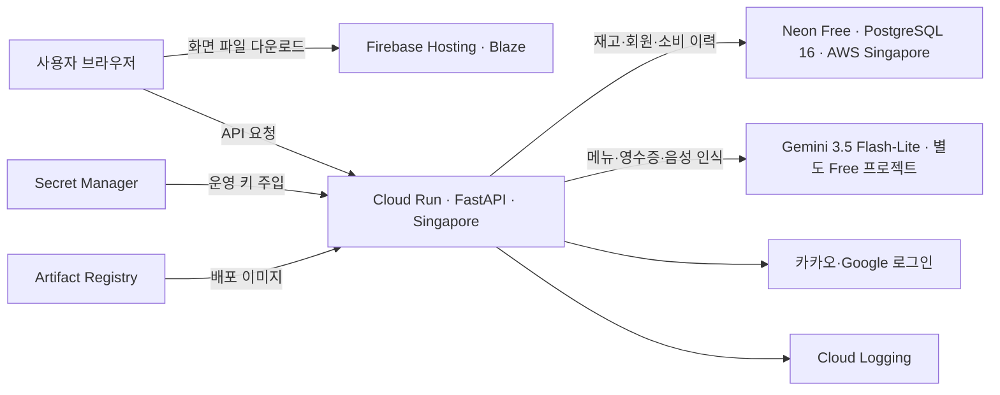

# 소규모 배포 비용과 API 사용량 검토

## 고정비 재확인 (2026-11-07)

11-04에 저장한 실제 배포 설정과 11-07에 확인한 공식 가격을 기준으로, 현재 구성에 월 정액이나 최소 사용료 약정은 없다. Cloud Run은 최소 인스턴스 0의 요청 기반 과금, Firebase Hosting은 Blaze 사용량 과금, Neon과 Gemini 프로젝트는 Free 설정이다. 서비스별 무료량을 충족하면 해당 항목의 비용은 0원이 될 수 있다. [Cloud Run](https://cloud.google.com/run/pricing), [Firebase Hosting](https://firebase.google.com/pricing), [Neon](https://neon.com/pricing), [Gemini Free](https://ai.google.dev/gemini-api/docs/pricing)

다만 **사용자가 적다는 조건만으로 전체 청구액 0원이 보장되지는 않는다**. Cloud Run의 외부 인터넷 전송 무료 1GiB는 북미 내 전송에 적용된다. 현재 Singapore에서 외부 사용자나 AWS의 Neon으로 보내는 트래픽에는 별도 전송 요금이 생길 수 있다. [네트워크 과금](https://cloud.google.com/run/pricing#networking)

요청 수와 별도로 이미지 저장량·비밀키 버전 수도 계산한다. Artifact Registry는 계정 합산 0.5GiB, Secret Manager는 계정 합산 활성 6버전과 월 조회 10,000회가 무료다. 비활성화된 키 버전도 활성 버전 과금 개수에 포함된다. 저장량이 무료량을 넘으면 접속이 없는 기간에도 요금이 누적될 수 있다. 11-04 확인한 Recipick 비밀키 버전은 6개였으며 다른 프로젝트와 무료량을 공유한다. [이미지 저장](https://cloud.google.com/artifact-registry/pricing), [비밀키 관리](https://cloud.google.com/secret-manager/pricing)

이번 요청의 운영 접근 제한에 따라 원격 리소스·DB·청구서는 재조회하지 않았다. 따라서 이 확인은 설정과 과금 방식에 관한 것이며 이번 달의 실제 청구액이나 남은 무료량을 확정한 결과는 아니다. 월 5,000원 예산은 기존 비용 알림 설정이며 자동 지출 상한 기능은 없다. 상세 한도와 초과 동작은 아래 11-04 확인표를 따른다.

## 현재 운영 사양·한도·과금 확인 (2026-11-04)

사용자 요청으로 실제 운영 설정과 최신 공식 요금을 다시 확인했다. 이 절이 아래의 초기 조사/선택 전 기록보다 우선한다. 배포 코드는 `de2e409`, 운영 기록은 `bc2a1f5`다. 실제 결제액/청구서나 공급자별 모든 무료 잔여량을 조회한 견적은 아니다. USD 단가이며 원화 청구 SKU·환율·세금은 별도다. 조사 이력 ID **`INFRA-LIMITS-20261104`**.

### 구성과 확인한 설정

| 구분 | 실제 운영 설정 |
| --- | --- |
| 웹 | `https://recipick-prod-1127.web.app`, React 정적 파일, 기본 HTTPS 도메인 |
| API | `https://recipick-api-inadpqyfnq-as.a.run.app`, Cloud Run 리비전 `recipick-api-onboard-de2e409`, 트래픽 100% |
| API 자원 | Singapore `asia-southeast1`, **1 vCPU / 1 GiB**, 요청 기반 과금, 최소 0·서비스 최대 1 인스턴스, 인스턴스당 동시 요청 2, 요청 제한 120초 |
| DB | Neon 프로젝트 `autumn-morning-81047996`, **Free (`free_v3`)**, PostgreSQL 16, AWS Singapore, **0.25 CU 고정**, 5분 유휴 절전. 조회 당시 `idle` |
| AI | `gemini-3.5-flash-lite`. 별도 프로젝트 `resolute-vault-478108-h0`의 **결제 비활성** 재확인. 호스팅 프로젝트 `recipick-prod-1127`은 결제 활성 |
| 비밀 보관 | Secret Manager의 운영 키 5종 사용. ENABLED 5버전 + 이전 카카오 DISABLED 1버전 = 과금 기준 버전 6개. 값은 조회/기록하지 않음 |
| 비용 알림 | 프로젝트 월 **5,000원**, 실제 지출 **50%·90%·100%** 알림 재확인. 자동 차단/월 청구 상한 아님 |

사진·녹음 원본은 처리 후 영구 저장하지 않는다. 사용자 데이터는 PostgreSQL에 저장하며 Firestore·Firebase Authentication·Neon Auth·유료 Cloud SQL·별도 파일 저장소는 현재 앱에서 사용하지 않는다. API는 Hosting 프록시를 거치지 않고 브라우저가 Cloud Run으로 직접 요청한다. 배포 빌드는 로컬 PC에서 수행한다.

### 무료량을 넘으면 자동 과금되는 부분

| 서비스 | 측정 단위와 무료량 | 초과 시 |
| --- | --- | --- |
| Firebase Hosting | 정적 파일 저장 **10 GB**, 가격표상 전송 **360 MB/일** | 저장 **$0.026/GB·월**, 전송 **$0.15/GB**. 현재 Blaze이므로 초과 사용량 자동 과금 |
| Cloud Run CPU | vCPU × 처리 시간. 미국 단가 기준 월 **180,000 vCPU초** 상당 할인 | 현재 Singapore Tier 2 **$0.0000336/vCPU초**에서 무료 할인 차감 후 청구 |
| Cloud Run RAM | 할당 GiB × 처리 시간. 미국 단가 기준 월 **360,000 GiB초** 상당 할인 | 현재 Singapore Tier 2 **$0.0000035/GiB초**에서 무료 할인 차감 후 청구 |
| Cloud Run 요청 | 월 **200만 요청** | **$0.40/100만 요청**. AI 호출 외 일반 API 요청도 포함 |
| Cloud Run 외부 전송 | 서버가 인터넷으로 내보낸 데이터 용량 | 지역·목적지별 네트워크 요금. 북미 내 1 GiB 무료 조건을 Singapore에 그대로 적용하지 않음 |
| Artifact Registry | 컨테이너 보관 **0.5 GiB·월** 포함 | 약 **$0.10/GiB·월**. 이전 배포 이미지도 보관량에 영향 |
| Secret Manager | 월 과금 기준 **6버전·읽기 10,000회** 포함 | 약 **$0.06/버전·월**, **$0.03/읽기 10,000회**. DISABLED 버전도 저장 과금 기준에 포함 |
| Cloud Logging | 로그 수집 **50 GiB/프로젝트·월** 포함 | **$0.50/GiB**, 기본 30일 보관 포함. 보관 기간 연장은 별도 |

공식 근거: [Hosting 가격표](https://firebase.google.com/pricing), [Cloud Run](https://cloud.google.com/run/pricing), [네트워크](https://cloud.google.com/vpc/network-pricing), [Artifact Registry](https://cloud.google.com/artifact-registry/pricing), [Secret Manager](https://cloud.google.com/secret-manager/pricing), [Logging](https://cloud.google.com/products/observability/pricing).

**Hosting 문서의 표기 차이:** 현재 가격표는 360 MB/일과 Blaze 무료량의 일별 계산을 명시하지만 [Hosting 상세 문서](https://firebase.google.com/docs/hosting/usage-quotas-pricing)는 월 10 GB로 설명한다. 월 총량만 믿고 하루에 몰아 쓰지 않도록 **일 360 MB 기준을 우선**해 안내한다. 일별/월별 표기가 완전히 같은 한도라고 단정하지 않는다.

**Cloud Run 무료 시간 환산:** 무료량은 같은 결제 계정의 프로젝트들이 공유하며 Tier 1 단가의 금액 할인으로 적용된다. 현재 Tier 2에서 다른 사용이 없다면 CPU 무료 할인 $4.32 ÷ $0.0000336 ≈ **128,571초 = 35.7시간**, RAM 무료 할인 $0.90 ÷ $0.0000035 ≈ **257,143 GiB초 = 1 GiB에서 71.4시간**이다. 둘은 별도 항목이다. 서버는 요청 처리뿐 아니라 시작/종료 중에도 과금 시간이 생기고, AI 응답을 기다리는 시간도 요청 처리 시간이다. 동시 요청은 같은 인스턴스 자원을 공유하므로 두 요청 시간을 단순 합산하면 실제보다 크게 추정할 수 있다.

지역 단가는 11월 4일 Google Cloud Billing Catalog API에서 직접 조회했다: CPU SKU `085C-A237-027A`, RAM `600C-3782-6708`, 요청 `2DA5-55D3-E679`. [Catalog API](https://cloud.google.com/billing/v1/how-tos/catalog-api), [무료 할인 기준](https://cloud.google.com/run/pricing). 조회 결과는 Git에서 제외한 `.deploy/cloudrun-price-review-20261104.json`에 보관한다. 최소 0·최대 1 설정도 금액을 5,000원으로 제한하지 않는다.

### 무료 한도를 넘으면 사용이 제한되는 부분

| 서비스 | 현재 한도 | 초과 결과 |
| --- | --- | --- |
| Neon Free DB | 프로젝트당 **1 GB**, 월 **100 CU-hours**, 외부 전송 월 **5 GB** | 계산량/전송량 소진 시 다음 기간 또는 업그레이드까지 compute 중단. 저장량 초과 시 용량 증가 작업 실패. 자동 유료 전환 없음 |
| Gemini Free | 모델별 RPM·입력 TPM·RPD. 마지막 사용자 제공 자료는 **15회/분·250,000 입력 토큰/분·500회/일** | 한 항목이라도 넘으면 429 등 사용 제한. 현재 결제 비활성 프로젝트에서는 초과 토큰을 자동 유료 처리하지 않음 |
| 앱 자체 AI 제한 | 계정당 **3회/분·20회/일**, 앱 전체 **12회/분·400회/일**, 계정당 진행 중 1건 | 제공자 호출 전에 거절/대기 안내. 별도 비용 부과 기능 없음 |

Neon의 **1 CU는 약 1 vCPU·4 GB RAM**이며 현재 0.25 CU는 약 0.25 vCPU·1 GB RAM이다. **100 CU-hours ÷ 0.25 CU = 월 400시간** 가동 가능량이다. 이 시간에는 쿼리 자체 시간뿐 아니라 절전 전 유휴 시간도 들어간다. 한 달 내내 켜 놓으면 30일 기준 180 CU-hours이므로 무료량을 초과한다. 일반 DB는 행 조회/쓰기 횟수마다 별도로 과금하는 구조가 아니다. [Neon 요금](https://neon.com/pricing), [Free 한도와 초과 동작](https://neon.com/docs/introduction/plans).

Gemini의 15/250,000/500은 **이번에 AI Studio에서 실시간 재조회한 수치가 아니다**. 오늘 확인한 것은 배포 모델과 해당 Google 프로젝트의 결제 비활성 상태다. 실제 계정 할당량은 AI Studio의 Rate limits가 최종 기준이다. RPM은 분당 요청, TPM은 분당 입력 토큰, RPD는 하루 요청이다. 토큰은 글자 수와 같지 않으며 사진/음성도 모델 입력 토큰으로 계산된다. 한도는 API 키가 아니라 Google 프로젝트 단위이므로 로컬·운영·같은 프로젝트의 다른 키가 합산된다. 앱의 로컬 DB·운영 DB 횟수 제한은 서로 독립적이다. [Gemini 한도](https://aistudio.google.com/docs/rate-limits).

앱은 메뉴 추천·영수증 사진 인식·음성 인식에 각각 **요청당 Gemini 1회**를 호출하고 같은 횟수 한도를 공유한다. 자동 재호출은 하지 않으며 실제 호출을 시도한 뒤 실패한 경우도 앱 횟수에 포함한다. 재고 조회/수동 등록/스마트 차감 확정/소비·폐기 조회/기준표 보관 기한 추천은 Gemini를 호출하지 않는다. 계정 일일 한도는 한국 자정, 앱 전체 일일 한도는 미국 태평양 자정 기준이다.

응답당 **최대 2,048 출력 토큰**을 설정했지만 월 토큰 예산이나 입력 TPM 차단은 앱에서 별도로 구현하지 않았다. `usageMetadata`의 실제 입력/출력 토큰을 저장하지 않으므로 현재 앱 기록만으로 기능별 정확한 토큰 비용을 계산할 수 없다. 이미지 최대 **5 MiB·2,000만 화소**, 음성 최대 **60초·2 MiB**는 업로드/처리 제한이며 넘으면 거절한다. 이 제한 자체가 유료 결제를 일으키지는 않는다.

추후 Gemini를 유료로 바꾸는 경우 현재 모델 Standard 단가는 **입력 $0.30/100만 토큰**, **출력 $2.50/100만 토큰**(생각 토큰 포함)이다. 가령 요청당 입력 2,000·출력 1,000이면 **$0.0031/회**, 월 1,500회면 **$4.65**다. 이는 가정 예시이며 현재 Free 프로젝트에 청구되는 금액이 아니다. [공식 모델 요금](https://aistudio.google.com/docs/pricing#gemini-3.5-flash-lite).

### 가족·지인 1~10명에서의 판단

10명 × 하루 AI 5회 × 30일 = **월 1,500회**. 서버 처리 시간이 건당 30초이고 요청들이 겹치지 않는다는 가정이면 45,000초(12.5시간)다. AI 처리분의 CPU/RAM은 현재 무료 할인 범위 안이다. 일반 API·시작/종료·다른 프로젝트 사용·네트워크·이미지/로그 보관은 별도이므로 **월 0원에 가까운 운영을 목표로 할 수 있지만 총액 0원이나 5,000원 이하를 보장하지 않는다**. 장시간 가동되는 DB의 400시간 한도, AI의 1인 하루 20회, 짧은 시간에 몰리는 앱 전체 분당 12회를 먼저 관찰하는 것이 유용하다.

비용/사용량은 Google Cloud Billing의 프로젝트별 Reports, Cloud Run 지표, Firebase Hosting Usage, Neon Usage, AI Studio Usage/Rate limits에서 확인한다. 현재 5,000원 알림은 Recipick 호스팅 프로젝트만 대상으로 하며 별도 Gemini/Neon 사용료까지 합산하는 예산은 아니다. 이번 작업은 조회와 문서 갱신·원격 푸시이며 서비스 사양·키·한도·결제·배포는 변경하지 않았다.

---

확인일: **2026-10-30 (한국 시간)**. 대상: 사용자가 확인한 **본인·가족·지인 1~10명**. 코드 기준: `codex/menu-recommendation`, `d3662fd`. 비용은 USD이며 세금·환율·선택적인 도메인 구입비는 별도다. 공급자 공식 문서와 현재 코드를 읽어 작성한 **계획**이며, 클라우드 계정 생성·결제 변경·실제 배포·성능 측정은 하지 않았다. 무료 조건은 가입·배포 시 다시 확인한다.

## 배포 준비 중 확인한 결정 (2026-11-02)

사용자는 아래 Firebase Hosting + Cloud Run + Neon Free 조합을 선택했고, **현재 Google 계정 사용·빈 운영 DB로 시작**을 확정했다. 이후 **월 5,000원 검토 예산과 비용 알림, 초과 과금 가능성 및 자동 차단 없음**을 승인했다. 새 프로젝트 `recipick-prod-1127`의 Cloud Run과 Firebase Hosting 공개를 완료했으며 실제 소셜 로그인 연동 검증은 진행 중이다. 별도 운영 JWT와 Secret Manager, Neon Free DB를 적용했다. [배포 실행 문서](deployment-runbook.md)와 [현재 인계 기록](code-audit-and-repair-log.md)을 따른다. 아래의 ‘선택 전/자원 미생성’ 설명은 조사 당시 상태다.

현재 규모에는 신규 $300 체험 계정이 필수는 아니다. 기존 Google Cloud 결제 계정에도 월 무료량이 적용되며 현재 계정은 활성 사용량 기반 유료 계정이다. 콘솔상 최근 30일 청구액은 0원이나, 실제 무료 잔여량이나 미래 청구액 보장은 아니다. 신규 이메일만으로 신규 고객 체험 자격이 보장되지 않는다. **무료량을 활용하는 사용량 기반 운영**이므로 네트워크·이미지 보관·빌드·초과 사용에 소액 비용이 생길 수 있다. [무료량과 체험의 차이](https://docs.cloud.google.com/free/docs/free-cloud-features)

Neon과 API 지역은 Singapore를 기준으로 준비한다. 무료 DB의 100 CU-hours는 0.25 CU에서 월 400시간에 해당하며, 5분 유휴 절전을 유지한다. 하루 종일 계속 사용하거나 깨우는 모니터링을 설정하면 무료량을 소진할 수 있다. Cloud Run 무료량은 같은 결제 계정의 다른 프로젝트와 합산된다. [Neon 무료량](https://neon.com/pricing), [Cloud Run 요금](https://cloud.google.com/run/pricing)

## 3개월 최소 비용 조건으로 보완한 추천 (2026-11-02)

사용자가 초기 운영 기간을 약 3개월로 구체화하고, 다른 신규 Google 계정 사용 가능성과 소액 결제 의향을 밝혔다. **운영비 최소화 기준의 우선 제안은 Firebase Hosting + Cloud Run + Neon Free + 기존 Gemini Free**다. 아래 10월 30일의 Render 무료 추천은 초기 조사 기록이며, 이번 제안이 사용자에 의해 선택된 것은 아니다. 계정 생성·결제 설정·실제 배포는 여전히 진행하지 않았다.

| 역할 | 제안 | 3개월 비용 판단 |
| --- | --- | --- |
| React 웹 화면 | Firebase Hosting의 정적 호스팅 | 저장 10GB·월 전송 10GB 무료량 내 $0. App Hosting이나 Firebase 인증/DB로 기능을 옮기는 제안은 아님 |
| FastAPI 서버 | Cloud Run, 요청 기반 과금·최소 인스턴스 0 | 월 무료량 내 연산 비용 $0. 자격이 있는 $300/90일 체험은 초과분에 추가 여유 제공. 빌드·이미지 보관·네트워크 등은 별도 |
| PostgreSQL | Neon Free | 프로젝트당 저장 1GB·월 100 CU-hours 등 무료량 내 $0 |
| AI | 현재 Gemini 3.5 Flash-Lite Free | 현재 합산 한도 유지. 실제 Free 상태·한도는 배포 전 재확인 |

근거: [Firebase Hosting 무료량](https://firebase.google.com/docs/hosting/usage-quotas-pricing), [Cloud Run 가격](https://cloud.google.com/run/pricing), [Neon 가격](https://neon.com/pricing). Firebase Hosting과 Cloud Run을 같은 호스팅용 Google 프로젝트에서 관리하면 별도 정적 호스팅 업체 계정은 필요 없다. 기존 Gemini 프로젝트는 분리하여 Free 상태를 유지하고, 호스팅 프로젝트의 결제 연결이 이를 바꾸지 않도록 확인한다.

가정 예시: 10명×AI 하루 5회×30일=월 1,500회이고 AI 요청당 서버 점유를 30초로 가정하면, 1 vCPU 기준 AI 처리분은 월 45,000 vCPU초다. Cloud Run 요청 기반 무료량은 us-central1 단가 기준 월 180,000 vCPU초·360,000 GiB초·200만 요청이다. **일반 API·시작 시간·지역별 단가·네트워크·빌드는 이 예시에 포함하지 않았으며 전체 청구액 견적이나 상한이 아니다.** 소규모 사용에서 무료량 활용 가능성이 높다는 추론의 근거로만 사용한다. 실제 배포 후 사용량을 확인한다. [공식 과금 기준](https://cloud.google.com/run/pricing)

비용 비교는 다음과 같다. 세금·도메인·초과분은 제외하고 DB·AI의 무료량을 유지한다고 가정한다.

| 선택 | 3개월 비용 | 선택 이유/제약 |
| --- | --- | --- |
| 위 Cloud Run 구성 | 무료량 내 $0 목표, 부대 비용 별도 | 최저 운영비 우선. 초기 설정과 사용량 확인 필요. 서버·DB 절전 복귀 지연이 있으며 실제 시간은 미측정 |
| Render 정적 사이트 + 유료 512MB 서버 + Neon Free | 서버 기본료 $7×3=$21 | 설정·월 기본료 예측이 간단하고 서버 절전 대기가 없음. DB 절전은 남고 512MB 이미지 처리 적합성 검증 필요 |
| 무료 정적 호스팅 + Railway Hobby 서버 + Neon Free | 기본료 $5×3=$15부터 | 월 $5의 자원 사용량 포함. 이를 넘으면 추가 과금이므로 고정 총액은 아님 |

출처: [Render 공식 요금 예시](https://render.com/articles/production-rails-hosting-guide), [Railway 플랜](https://docs.railway.com/pricing/plans), [Cloud Run 절전/자동 확장](https://docs.cloud.google.com/run/docs/about-instance-autoscaling).

Google 체험은 **이전에 유료 Google Cloud/Maps/Firebase 고객이 아니고 체험 신청 이력도 없어야 한다. 신규 이메일만으로 자격이 보장되지 않는다.** $300은 90일 유효하므로 달력상 3개월과 같지 않으며, 체험 종료 후 계속 운영하려면 유료 결제 계정 전환이 필요하다. 전환하지 않으면 자원이 중단된다. 체험 대상이 아니어도 결제 계정에 연결된 Cloud Run의 월 무료량은 활용할 수 있다. [체험 자격·종료 정책](https://docs.cloud.google.com/free/docs/free-cloud-features)

선택 시 제안할 설정은 최소 인스턴스 0, 작은 최대 인스턴스 수, 요청 기반 과금, 불필요한 서버 깨우기 요청 금지, 보관 이미지 정리 정책, 월 $5 수준의 검토용 비용 알림이다. 이 금액은 예측 청구액이나 자동 차단 상한이 아니다. **알림 전용 예산은 사용·청구를 차단하지 않는다.** [예산 알림의 범위](https://docs.cloud.google.com/billing/docs/how-to/budgets)

구현 전 확인점: Cloud Run은 결제 계정이 필요하고 같은 프로젝트의 Firebase는 Blaze로 전환되며 무료 포함량 초과분은 과금된다. Firebase Hosting에서 API를 Cloud Run으로 전달하는 방식에는 60초 제한이 있어 현재 AI 요청 제한·절전 복귀와 함께 검증해야 한다. API 직접 연결 또는 요청 시간 조정 여부는 배포 준비 때 정한다. 장기간 유료 DB가 필요한 Cloud SQL은 이번 최소 비용안에 넣지 않는다. 실제 배포 전 별도 운영 JWT 키 준비 여부를 확인한다. [Firebase/Cloud Run 연결 조건](https://firebase.google.com/docs/hosting/cloud-run)

## 초기 추천 구성 (2026-10-30)

첫 소규모 시험 운영에는 **Render Static Site + Render Free Web Service + Neon Free PostgreSQL + 기존 Gemini Free**를 추천한다. 프런트 React 정적 파일과 Python FastAPI를 Render에 각각 올리고 DB는 Neon에 둔다. 기본 제공 HTTPS 주소를 사용하면 별도 도메인 구매가 필요 없다. 각 무료 한도 안에서는 월 $0를 목표로 할 수 있지만, 인원수만으로 사용량이 보장되지는 않는다.

| 구성 요소 | 무료 조건·제약 | 이 프로젝트에서의 의미 |
| --- | --- | --- |
| Render Static Site | 정적 사이트 무료. 전송량·빌드 시간은 계정의 포함량 적용 | React 빌드 결과를 배포. 로그인 콜백 등 SPA 경로 설정 필요 |
| Render Free Web Service | 15분 무접속 시 절전, 재기동 약 1분. 워크스페이스 월 750시간 | 오랜만에 접속하면 API·로그인이 느릴 수 있음. 소규모 시험 운영용 |
| Neon Free PostgreSQL | 기간 제한 없음, 프로젝트당 저장 1GB·월 100 CU-hours, 5분 유휴 시 절전 | 현재 PostgreSQL 구조 유지. DB 사용 시간·용량을 함께 확인 |
| Gemini 3.5 Flash-Lite Free | 무료 입력·출력, 계정에 적용된 요청·토큰 한도 내 사용 | 메뉴·영수증·음성의 현재 합산 제한 유지 |

출처: [Render 무료 서비스](https://render.com/docs/free), [정적 사이트](https://render.com/docs/static-sites), [Neon 요금](https://neon.com/pricing), [Gemini 요금](https://ai.google.dev/gemini-api/docs/pricing#gemini-3.5-flash-lite).

- Render는 Free 인스턴스를 정식 운영용으로 권장하지 않는다. 첫 요청 지연을 허용하는 가족·지인 베타로 시작하는 안이다. 결제 수단이 연결된 경우 포함 전송량·빌드 시간을 넘으면 추가 비용이 발생할 수 있으므로, 단순히 인스턴스가 Free라는 이유로 모든 사용이 무조건 무료라고 보지 않는다. [무료 서비스 조건](https://render.com/docs/free)
- **Render Free PostgreSQL은 생성 후 30일에 만료**되므로 지속 보관할 DB로 추천하지 않는다. Neon은 DB 가동 시간도 제한된다. 예를 들어 0.25 CU로 400시간 가동하면 100 CU-hours이므로, 24시간 상시 가동을 전제로 무료라고 계산하면 안 된다. [Render](https://render.com/docs/free), [Neon](https://neon.com/pricing)
- 절전 지연이 불편하면 백엔드만 Render 유료 512MB 인스턴스(`0.5c-512mb`) 월 $7로 올리는 경로가 있다. 프런트·DB 무료 한도 유지 시 기본 비용은 월 $7이고 초과 사용은 별도다. 실제 영수증 처리 메모리가 512MB에 적합한지는 배포 전 측정해야 한다. [Render 공식 비용 예시](https://render.com/articles/production-rails-hosting-guide)
- 현재 영수증 사진·녹음 원본은 앱의 영구 파일 저장소에 보관하지 않는다. 첫 버전에는 별도 S3 같은 파일 저장소가 필수는 아니다. 사용자 재고·이력은 외부 PostgreSQL에 저장한다.

## 신규 가입 체험까지 포함한 대안

| 선택지 | 무료 체험/크레딧 | 종료 후·주의점 | 판단 |
| --- | --- | --- | --- |
| Railway | 신규 계정 $5, 최대 30일. 둘 중 먼저 소진되면 종료 | 이후 Free는 월 $1 크레딧. Hobby는 월 $5에 $5 사용량 포함, 초과 별도. Limited Trial은 외부 네트워크 제한 | 배포 체험은 간편하지만 Python+DB가 계속 무료라고 보장할 수 없음 |
| Google Cloud / Cloud Run | 자격 있는 신규 고객 $300, 최대 90일 | 미전환 체험은 종료 시 중단. 유료 전환 후에는 크레딧·무료량 초과 과금. 결제 수단 확인 필요 | 여유 있는 체험과 향후 확장에 적합하나 컨테이너·권한·과금 설정이 더 복잡 |
| AWS Free Plan | 신규 고객 가입 시 $100, 활동 완료로 추가 최대 $100. 최대 6개월 또는 크레딧 소진까지 | 대상 서비스 제한. 계속 이용하려면 Paid 전환 필요. 기존/과거 계정은 신규 혜택 대상이 아닐 수 있음 | 기간은 길지만 현재 규모에는 서버·DB 운영 준비가 상대적으로 많음 |

출처: [Railway 체험](https://docs.railway.com/pricing/free-trial), [Railway 플랜](https://docs.railway.com/pricing/plans), [Google Cloud 체험](https://cloud.google.com/signup-faqs), [AWS Free Tier FAQ](https://aws.amazon.com/free/free-tier-faqs/).

Cloud Run에는 체험 이후에도 요청 기반 과금의 월 무료량(200만 요청, 180,000 vCPU초, 360,000 GiB초)이 있지만 지역별 단가·CPU/메모리 시간·빌드·이미지 저장·네트워크 비용을 함께 계산해야 한다. **앱 서버 HTTP 요청 200만 회는 Gemini AI 호출 200만 회 무료라는 뜻이 아니다.** [Cloud Run 요금](https://cloud.google.com/run/pricing)

**신규 Google Cloud $300 체험 크레딧으로 Gemini API 비용을 낼 수 없다.** 2026년 3월 이후 Gemini API/AI Studio는 해당 체험에서 제외된다. 또한 사용자가 과거 Gemini 유료 Tier 1을 이용했으므로 Google Cloud 신규 고객 혜택 대상인지 별도 확인해야 한다. 이번에는 계정 자격을 확인하지 않았다. 호스팅용 결제 연결이 현재 Gemini Free 설정에 영향을 주는지도 실제 구성 시 확인한다. [Gemini 결제 안내](https://ai.google.dev/gemini-api/docs/billing)

Railway의 미검증 Limited Trial에서는 Gemini·OAuth 외부 연결이 제한될 수 있고, 체험 볼륨은 크레딧 만료 30일 뒤 삭제 대상이다. 시험 DB라도 종료 전에 보존·이전 계획이 필요하다. [Railway 체험 조건](https://docs.railway.com/pricing/free-trial)

## 현재 키와 외부 호출 위치

현재 설정 모델은 `gemini-3.5-flash-lite`다. Gemini·카카오·Google OAuth 설정 값의 존재를 확인했으며 키 원문은 출력·기록하지 않았다. 설정이 존재한다는 사실이 공급자 계정의 현재 결제 등급·유효성을 증명하지는 않는다.

| 기능/설정 | 외부 호출 | 빈도·전송 내용 |
| --- | --- | --- |
| `GEMINI_API_KEY`: 메뉴 추천 | Gemini `generateContent` | 추천 요청당 1회. 선택 냉장고의 재고·수량·기한, 우선 재료, 알레르기 등 선호 정보 |
| 같은 키: 영수증 인식 | 같은 Gemini API | 인식 요청당 1회. 사진과 지시문. 최대 20개 후보를 한 응답으로 처리하며 상품별 1회가 아님 |
| 같은 키: 음성 인식 | 같은 Gemini API | 인식 요청당 1회. 최대 60초 녹음과 지시문. 녹음 초마다 호출하는 스트리밍 구조가 아님 |
| 카카오/Google OAuth ID·secret | 해당 로그인 제공자의 토큰·프로필 API | 성공적인 신규 소셜 로그인에서 백엔드 기준 토큰 교환 1회+프로필 조회 1회. 브라우저 인증 이동은 별도 |
| `JWT_SECRET_KEY` | 외부 호출 없음 | 앱 자체 로그인 토큰 서명·검증. 앱 토큰 갱신도 로컬 처리하며 Gemini를 사용하지 않음 |
| `DATABASE_URL` 자격 정보 | PostgreSQL 연결 | 재고·공유·이력 등 일반 API에서 사용. 비용은 DB 호스팅 자원 사용량으로 판단 |

수동 등록·수정·삭제·소비·폐기, 가족 공유, 대시보드 조회, 기준표 보관 기한 추천, 스마트 차감 확인·저장, 기존 메뉴로 다시 먹기는 **Gemini 0회**다. 사진/음성 인식 결과를 수정하고 저장할 때도 추가 호출하지 않는다. 인식 또는 추천을 다시 요청하면 새 호출이다. 자동 AI 호출·자동 재시도·다른 모델로의 자동 전환·검색/지도 그라운딩·별도 음성 인식 유료 API는 현재 없다.

코드 근거: [Gemini 공통 클라이언트](../backend/app/ai/gemini_client.py), [메뉴 서비스](../backend/app/services/recipe_service.py), [영수증 서비스](../backend/app/services/receipt_service.py), [음성 서비스](../backend/app/services/voice_service.py), [OAuth](../backend/app/utils/oauth.py), [설정](../backend/app/config.py).

사진은 JPEG/PNG 최대 5MiB·2천만 화소를 검사하고 메타데이터를 제거한 JPEG로 보낸다. **사진에 인쇄된 이름·전화번호 등이 자동으로 가려지는 것은 아니다.** 음성은 최대 60초 WAV를 보낸다. 모델의 출력 개인정보 배제 지시는 입력 전송 차단과 다르다. Gemini Free는 입력·출력의 제품 개선 사용 조건이 있으므로 실제 사용자에게 사진·음성이 Google AI로 전달된다는 안내와 이 조건을 배포 전에 검토한다. [Gemini 무료/유료 데이터 사용 구분](https://ai.google.dev/gemini-api/docs/pricing#gemini-3.5-flash-lite)

## 한도: 코드에서 확인된 값과 이전 계정 자료 구분

| 범위 | 분당 요청 | 하루 요청 | 분당 토큰 | 확인 근거 |
| --- | ---: | ---: | ---: | --- |
| 앱 계정 1명 | 3 | 20 | 별도 제한 없음 | 현재 코드 |
| 앱 전체, 같은 DB를 쓰는 서버 합산 | 12 | 400 | 별도 제한 없음 | 현재 코드 |
| Google 프로젝트의 해당 모델 | 15 | 500 | 250,000 | 사용자가 이전에 공유한 AI Studio 자료, **현재 실시간 재조회 아님** |

세 AI 기능이 한도를 공유한다. 개인 하루는 한국 자정, 앱 전체 하루는 미국 태평양 자정(서머타임 반영) 기준이다. 한 계정은 동시에 한 AI 요청만 처리한다. 한도를 넘으면 429 안내를 반환하며 자동 대기열은 없다. Gemini 호출 직전 앱 DB에 시도를 기록하므로 호출 후 실패·시간 초과도 앱 횟수를 소모한다. 권한·파일·입력 검증 단계에서 거절된 요청은 AI 횟수를 소모하지 않는다. 근거: [사용량 제한 코드](../backend/app/services/recipe_usage.py).

공급자 한도는 키별로 새로 생기는 것이 아니다. **같은 Google 프로젝트의 여러 키·개발 테스트·배포 서비스 사용량은 합산**된다. 개발과 운영의 DB가 다르면 앱의 400회 제한도 서로 별도로 집계되므로 공급자 합산 500회를 자동 보장하지 않는다. Google의 실제 적용 한도·현재 잔여량·Free 등급은 배포 직전에 AI Studio에서 재확인해야 한다. [공급자 한도 안내](https://ai.google.dev/gemini-api/docs/rate-limits)

## 예상 사용량과 비용

아직 배포 트래픽 실측이 없어 **1인 하루 AI 5회**(예: 메뉴 3회+영수증 1회+음성 1회)를 계산 가정으로 둔다. 장보기는 매일 하지 않을 수 있으므로 실제 빈도 예측값이 아니라 비교용 시나리오다. 월은 30일로 계산한다.

| 이용자 | AI 호출/일 | AI 호출/월 | 현재 Free 유지·한도 이내 AI 비용 |
| --- | ---: | ---: | ---: |
| 1명 | 5 | 150 | $0 |
| 5명 | 25 | 750 | $0 |
| 10명 | 50 | 1,500 | $0 |

10명이 위와 같이 사용하면 앱 일일 400회 제한에 비해 총량 여유가 있다. 다만 같은 분에 여러 번 몰리면 전체 분당 12회 제한이 먼저 적용된다. 서버 메모리·DB 가동 시간·토큰 한도는 별도이므로 이 표만으로 무중단 운영이나 무료 호스팅을 보장하지 않는다.

Gemini 유료로 전환할 경우 현재 Standard 단가는 입력 100만 토큰당 $0.30, 출력(생각 토큰 포함) 100만 토큰당 $2.50다. **평균 입력 2,000·출력 1,000 토큰이라고 가정하면** 1회 $0.0031, 월 1,500회 $4.65다. 실제 영수증·음성·재고 길이별 토큰 수를 측정한 견적이 아니며, 현재 무료 사용에 이 비용이 청구된다는 뜻도 아니다. 호스팅 비용은 별도다. [모델 요금](https://ai.google.dev/gemini-api/docs/pricing#gemini-3.5-flash-lite)

현재 출력 설정은 요청당 최대 2,048토큰이다. 앱은 요청 횟수만 제한하며 전체 입력 토큰 예산·분당 토큰 제한은 구현하지 않았다. 따라서 요청 횟수 제한을 정확한 비용 상한으로 해석하지 않는다.

## 현재 확인할 수 없는 값과 관측 범위

- 이번에 AI Studio 계정에 접속하지 않아 **지금까지의 실제 누적 사용량·현재 남은 횟수·현재 청구액**은 확인하지 않았다. 사용자 제공 과거 표의 `0 / 한도`를 지금 사용량으로 옮겨 적지 않는다.
- 앱 DB에는 사용자·시작/종료 시간 중심의 시도 기록이 있다. 2일보다 오래된 기록은 다음 정상 예약 시 정리하므로 월별 보고용 기록이 아니다.
- 기능 종류·입력/출력 토큰·금액을 저장하지 않고 `usageMetadata`도 사용하지 않는다. 따라서 지금 앱만으로 메뉴/영수증/음성별 정확한 월 비용을 나눠 볼 수 없다.
- 초기 배포 후 AI Studio 사용량, Render 메모리·전송량, Neon CU-hours·저장량을 확인하면 무료 유지 가능성을 실제 수치로 판단할 수 있다. 기능별 계측 화면은 별도 후속 제안이며 이번에 구현하지 않았다.

## 배포 전에 필요한 현재 항목

플랫폼 선택 후 아래를 하나의 배포 준비 항목으로 구현·검증하고 실제 공개 범위를 확인한다. 기존 점검 01~11을 재개하거나 새 기능을 자동으로 추가하는 계획은 아니다.

1. **배포 API 연결·경로:** 프런트는 현재 `/api/v1`을 사용하고 Vite 개발 프록시가 로컬 백엔드로 전달한다. 운영에는 API 주소 설정 또는 동일 출처 프록시가 필요하다. 별도 주소를 쓰면 일반 요청뿐 아니라 직접 `/api/v1/auth/refresh`를 호출하는 토큰 갱신도 함께 연결한다. `/recipes`·OAuth 콜백 직접 진입에 SPA fallback을 설정한다. [클라이언트](../frontend/src/api/client.ts), [Vite 설정](../frontend/vite.config.ts)
2. **DB·실행 환경:** 운영용 PostgreSQL을 분리하고 asyncpg의 TLS 연결·마이그레이션·DB 절전 복귀를 검증한다. 현재 엔진에는 `pool_pre_ping`이 없어 오래된 연결 복구 확인이 필요하다. `APP_ENV=production`, 올바른 빌드/시작 명령·포트·Python/Node 버전을 설정한다. 기존 로컬 데이터 이전 여부는 사용자와 정하며 임의 이전하지 않는다. [DB 연결](../backend/app/database/connection.py)
3. **운영 비밀키:** `backend/.env`는 로컬 개발용이다. **별도의 운영 JWT 서명 키를 생성하여 서버의 `JWT_SECRET_KEY`로 설정**해야 하며 재사용하지 않는다. 실제 배포 전에 준비 여부만 확인하고 키 원문을 요청하거나 문서·Git·브라우저 번들에 넣지 않는다. Gemini와 OAuth 비밀값도 서버 환경변수에만 설정한다.
4. **운영 로그인·마이크:** 실제 HTTPS 주소에 맞춰 `FRONTEND_URL`, 카카오/Google 콜백 URL과 공급자 콘솔 허용 주소를 맞춘다. CORS·가족 초대 링크·실기기 마이크 권한을 확인한다.
5. **무료 환경 검증:** 절전 뒤 첫 로그인·30초 제한이 있는 토큰 갱신, DB 재연결, 여러 계정 동시 요청, 큰 영수증 이미지의 512MB 메모리 적합성을 검증한다. 무료 DB 복구 범위를 확인하고 보존할 데이터의 내보내기 방법을 정한다.
6. **배포 대상·등급:** 현재 최신 개발은 원격 `codex/menu-recommendation`에 있다. `main`을 자동 선택하면 최신 기능이 빠질 수 있다. 배포 브랜치를 명시하거나 별도 합의 후 병합한다. Gemini Free·합산 한도 및 호스팅 무료/체험 선택을 콘솔에서 재확인한다.

현재 플랫폼 결정·운영 키 준비 확인은 대기 중이다. 이 검토에서는 실행 코드·`.env`·데이터·모델·한도를 바꾸지 않았다. 테스트는 새로 돌리지 않고 코드와 공식 문서 대조 및 문서 diff를 검토했다. 배포 시 실제 로그인·사진·음성·공유·차감 검증이 별도로 필요하다.
